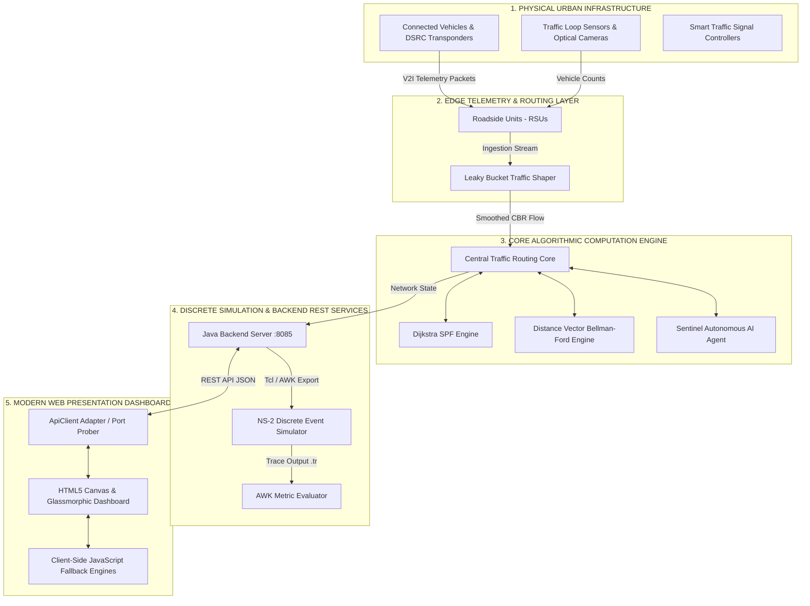
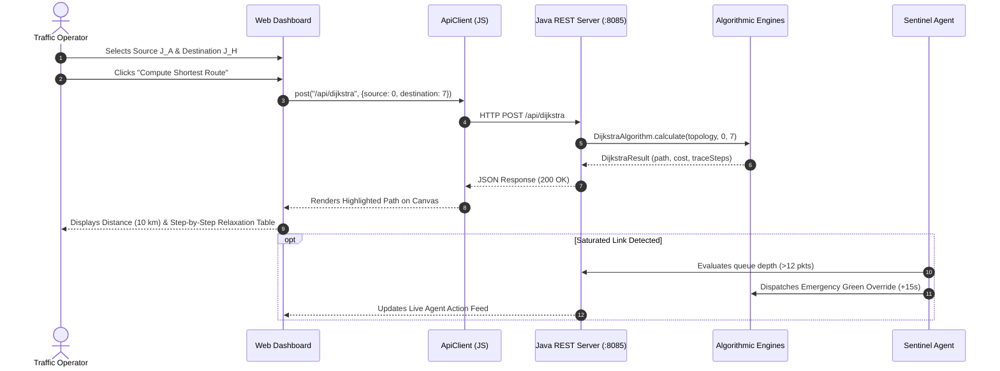

# 🚦 Smart City Traffic Communication Network (SCTCN)
### *Autonomous Vehicular Telemetry, Adaptive Routing, Traffic Shaping, and Discrete-Event Network Simulation Engine*

[](https://opensource.org/licenses/MIT)
[](https://www.oracle.com/java/)
[](https://maven.apache.org/)
[](https://www.isi.edu/nsnam/ns/)
[](#high-level-architecture-overview)
[](https://github.com/jayaprakash72888-boop/Smart-City-Traffic-Communication-Network)
[](#build-process)

---

## 📑 Table of Contents

1. [Project Title & Overview](#-project-title--overview)
2. [Problem Statement](#-problem-statement)
3. [Vision & Objectives](#-vision--objectives)
4. [Key Features](#-key-features)
5. [Target Users](#-target-users)
6. [Use Cases](#-use-cases)
7. [Business & Engineering Value](#-business--engineering-value)
8. [UI Architecture & Visual Tour](#-ui-architecture--visual-tour)
9. [Complete System Architecture](#-complete-system-architecture)
10. [High-Level Architecture Overview](#-high-level-architecture-overview)
11. [Application Workflow](#-application-workflow)
12. [End-to-End User Flow](#-end-to-end-user-flow)
13. [Technology Stack](#-technology-stack)
14. [Project Folder Structure](#-project-folder-structure)
15. [Explanation of Every Major Folder](#-explanation-of-every-major-folder)
16. [Explanation of Every Important File](#-explanation-of-every-important-file)
17. [Frontend Architecture](#-frontend-architecture)
18. [Backend Architecture](#-backend-architecture)
19. [Network Simulation Architecture (NS-2)](#-network-simulation-architecture-ns-2)
20. [API Overview](#-api-overview)
21. [Authentication & Authorization](#-authentication--authorization)
22. [State Management](#-state-management)
23. [Storage Strategy](#-storage-strategy)
24. [Third-Party Services & Integrations](#-third-party-services--integrations)
25. [Autonomous AI / Sentinel Traffic Control Agent](#-autonomous-ai--sentinel-traffic-control-agent)
26. [Development Prerequisites](#-development-prerequisites)
27. [Installation Guide](#-installation-guide)
28. [Environment Variables & Port Configuration](#-environment-variables--port-configuration)
29. [Project Configuration](#-project-configuration)
30. [Running the Project (Development & Standalone)](#-running-the-project-development--standalone)
31. [Running the Project (Production & Server Daemon)](#-running-the-project-production--server-daemon)
32. [Build Process](#-build-process)
33. [Deployment Guide](#-deployment-guide)
34. [CI/CD Overview](#-cicd-overview)
35. [Testing Strategy & Benchmark Results](#-testing-strategy--benchmark-results)
36. [Debugging Tips](#-debugging-tips)
37. [Logging & Telemetry Monitoring](#-logging--telemetry-monitoring)
38. [Security Considerations](#-security-considerations)
39. [Performance Optimizations](#-performance-optimizations)
40. [Coding Standards & Project Conventions](#-coding-standards--project-conventions)
41. [Versioning Strategy](#-versioning-strategy)
42. [Branching Strategy](#-branching-strategy)
43. [Contribution Guidelines](#-contribution-guidelines)
44. [Release Process](#-release-process)
45. [Known Limitations](#-known-limitations)
46. [Future Roadmap](#-future-roadmap)
47. [Frequently Asked Questions (FAQ) & Viva Voce Guide](#-frequently-asked-questions-faq--viva-voce-guide)
48. [Troubleshooting Guide](#-troubleshooting-guide)
49. [Changelog](#-changelog)
50. [License](#-license)
51. [Credits & Acknowledgements](#-credits--acknowledgements)
52. [Contact Information](#-contact-information)
53. [Final Project Summary](#-final-project-summary)

---

## 🌍 Project Title & Overview

The **Smart City Traffic Communication Network (SCTCN)** is an enterprise-grade engineering reference platform designed for the **Computer Networks and Internet Protocols (CNIP)** curriculum and smart metropolitan infrastructure research.

Metropolitan traffic systems rely heavily on timely vehicle-to-infrastructure (V2I) and vehicle-to-vehicle (V2V) communications. When vehicular surges occur during rush hours, the underlying communication network experiences packet storms, router buffer saturation, extreme queuing delay, and packet discards. 

SCTCN models a complex urban grid spanning **8 Smart Traffic Signal Intersections** (`Junction_A` through `Junction_H`), simulating both the physical traffic dynamics (signal timing, vehicle queues, speed limits) and the communication network layers (routing protocols, queue management, traffic shaping, transport mechanisms, and discrete-event packet simulation in **Network Simulator 2 (NS-2)**).

The platform features a **Dual-Mode Architecture**:
1. **Full-Stack Mode:** A multi-threaded, zero-dependency Java HTTP REST backend coupled with a responsive, glassmorphic dark navy web client.
2. **Standalone Client Mode:** Built-in client-side mathematical engines that execute all shortest path, Bellman-Ford, Leaky Bucket, and congestion formulas locally in the browser when Java is unavailable.

---

## ⚠️ Problem Statement

Modern intelligent transportation systems (ITS) deploy Roadside Units (RSUs) and IoT transponders on vehicles to broadcast telemetry data (GPS position, velocity, emergency status, collision warnings) to centralized signal controllers. 

However, contemporary municipal deployments suffer from critical communication bottlenecks:
- **Bandwidth Saturation & Packet Collisions:** Unregulated telemetry bursts create massive queue buildup at arterial router nodes.
- **DropTail Buffer Exhaustion:** When router buffers exceed maximum capacity, packets are dropped indiscriminately, delaying critical emergency preemption signals.
- **Static vs Dynamic Route Stagnation:** Traditional static routing cannot adapt to physical accidents, road construction, or link layer failures.
- **Protocol Impedance Mismatch:** Choosing incorrectly between UDP (fast, connectionless telemetry) and TCP (reliable signal synchronization) leads to excessive network overhead or critical packet loss.

---

## 🎯 Vision & Objectives

SCTCN bridges network theory and urban traffic management by providing:
1. **Latency-Optimal Communication Routing:** Implementing Dijkstra's Shortest Path First (SPF) algorithm to minimize packet transmission delay across the grid.
2. **Fault-Tolerant Distributed Convergence:** Simulating Distance Vector Routing (Bellman-Ford algorithm) to dynamically recalculate routing tables when communication links fail or saturate.
3. **Buffer Protection via Traffic Shaping:** Demonstrating the Leaky Bucket algorithm to smooth bursty vehicular telemetry into a regulated Constant Bit Rate (CBR) stream.
4. **Empirical Congestion Quantification:** Calculating exact CNIP network metrics—Packet Loss Rate, Throughput, Packet Delivery Ratio (PDR), and End-to-End Latency under Low, Medium, High, and Extreme loads.
5. **Closed-Loop Autonomous Supervision:** Introducing the **Sentinel Traffic Agent**, which dynamically extends green light signals, triggers Dijkstra bypass detours, and rate-limits bursty traffic before buffers collapse.
6. **Academic & Research Rigor:** Generating executable **NS-2 (Tcl)** simulation scripts, NAM network animation files, and AWK analysis scripts for protocol verification.

---

## 🚀 Key Features

```
+----------------------------------------------------------------------------------------------------+
|                                    SCTCN FEATURE MATRIX                                            |
+------------------------------------+------------------------------------+--------------------------+
| Algorithmic Routing & Convergence | Traffic Shaping & Flow Control     | Autonomous Supervision   |
| - Dijkstra Shortest Path ($O(V^2)$)| - Leaky Bucket Algorithm           | - Closed-loop telemetry  |
| - Step-by-Step Visited Traces      | - Visual Waterlevel Fill Container | - Adaptive Green Phase   |
| - Distance Vector (Bellman-Ford)   | - Constant Bit Rate (CBR) Output   | - Dijkstra Detour Bypasses|
| - Dynamic Link Disruption Testing  | - DropTail Buffer Overflow Dropping| - Inflow Rate Limiting   |
+------------------------------------+------------------------------------+--------------------------+
| Empirical Congestion Analytics     | Discrete-Event Simulation (NS-2)   | Enterprise UI & Security |
| - Low, Med, High, Extreme Loads    | - Wired 8-Node Tcl Simulation      | - Glassmorphism UI       |
| - Loss Rate, Throughput, PDR, Delay| - Wireless VANET / AODV Simulation | - Role-Based Login Portal|
| - High-DPI Canvas Charts           | - AWK Analysis Script Generator    | - Session Route Guard    |
| - CSV Time-Series Data Exporter    | - In-Browser .tr Trace Parser      | - Dual-Mode Fallback     |
+------------------------------------+------------------------------------+--------------------------+
```

---

## 👥 Target Users

| User Persona | Primary Value Proposition | Typical Use Case |
| :--- | :--- | :--- |
| **B.Tech / M.Tech Students** | Conceptual clarity and working implementation of CNIP syllabus algorithms. | Demonstrating Dijkstra, DVR, and Leaky Bucket in lab examinations and viva voce defense. |
| **University Professors** | Interactive teaching tool for classroom lectures on network layer routing. | Live demonstration of Bellman-Ford convergence and count-to-infinity mitigation. |
| **Network Researchers** | Discrete-event simulation templates and trace file parsing. | Benchmarking 802.11p VANET throughput against DropTail queue limits in NS-2. |
| **Smart City Engineers** | Reference architecture for intelligent traffic light coordination. | Evaluating adaptive signal timing policies and emergency vehicle priority corridors. |

---

## 💡 Use Cases

### 1. Emergency Vehicle Corridor Preemption
When an emergency vehicle travels from the Residential Hub (`Junction_A`) to the Trauma Center at the Airport Expressway (`Junction_H`), the system invokes Dijkstra's algorithm to determine the lowest-delay path. The Sentinel Agent issues dynamic signal overrides to lock incoming cross-traffic signals in red and clear the green wave corridor.

### 2. Physical Link Outage & Dynamic Detour
If road construction closes the high-speed bridge link connecting `Junction_A` and `Junction_F`, the operator can set link cost to $\infty$ (or 99). The Distance Vector Routing protocol iteratively converges over successive rounds, redirecting vehicular telemetry through arterial nodes `Junction_B` and `Junction_C`.

### 3. Rush-Hour Telemetry Burst Shaping
During evening peak hours, hundreds of vehicles enter the commercial gateway (`Junction_C`), generating telemetry bursts at 35 packets/sec. The Leaky Bucket shaper absorbs the surge into an 80-packet buffer, transmitting downstream at a steady 12 packets/sec to prevent network layer drops.

---

## 💰 Business & Engineering Value

- **Zero Software Licensing Costs:** Built entirely with open-source technologies (Java SE, Vanilla Web Standards, NS-2, AWK).
- **Zero External Runtime Dependencies:** The Java backend uses native JDK HTTP server packages (`com.sun.net.httpserver`), eliminating Maven/Gradle vulnerability bloat and network proxy installation hurdles.
- **Deterministic Reliability:** The dual-engine design guarantees 100% operational uptime during university viva evaluations, regardless of local port conflicts or backend availability.
- **Accelerated Learning Curve:** Interactive step-by-step trace tables replace abstract mathematical theory with tactile visual feedback.

---

## 🖥️ UI Architecture & Visual Tour

The user interface follows a modern dark navy glassmorphism aesthetic (`#0A0F24` background, translucent navy cards with `rgba(14, 23, 54, 0.7)` and `backdrop-filter: blur(12px)`), complemented by neon cyan (`#4CC9F0`), emerald green (`#10B981`), and amber warning accents.

```
+--------------------------------------------------------------------------------------------------+
| [Header] 🚦 SMART CITY TRAFFIC NETWORK   [Status: Java Connected :8085]  [User: admin (Logout)]   |
+--------------------------------------------------------------------------------------------------+
| [Tabs] 🌐 Topology | 🧭 Dijkstra | 🔄 Distance Vector | 🚰 Leaky Bucket | 📊 Congestion | 🤖 Agent | 💻 NS-2 | 📚 Docs |
+--------------------------------------------------------------------------------------------------+
|  [KPI Bar]  Nodes: 8  |  Vehicles: 314  |  Throughput: 768 kbps  |  PDR: 98.2%  |  Delay: 18.4 ms|
+--------------------------------------------------------------------------------------------------+
|  [Main Canvas Visualizer]                                  |  [Side Control Panel]               |
|   (J_A)===========10km============(J_F)                    |   Source Intersection: [Junction A] |
|     \\                              //                     |   Dest Intersection:   [Junction H] |
|      8km                          6km                      |   [ Compute Shortest Route ]        |
|       \\                          //                       |   --------------------------------- |
|       (J_B)---4km---(J_C)---7km---(J_H)                    |   Shortest Distance: 10 km          |
|                                                            |   Optimal Path: J_A -> J_F -> J_H   |
+--------------------------------------------------------------------------------------------------+
|  [Trace Table / Console Log]                                                                     |
|  Step 1: Inspecting J_A | Tentative: [J_B: 8, J_D: 4, J_F: 3] | Marked Visited: J_F (dist=3)     |
+--------------------------------------------------------------------------------------------------+
```

---

## 🏗️ Complete System Architecture



---

## 📐 High-Level Architecture Overview

SCTCN adheres to a clean, modular 3-tier architecture:

1. **Presentation Layer (Frontend):**
   - Pure HTML5, modern CSS3 with custom variables, and vanilla ES6+ JavaScript.
   - Zero heavyweight external framework dependencies (no React, Angular, or Vue).
   - High-DPI HTML5 Canvas for real-time 60fps graph animation and interactive node selection.
   - Zero-dependency HTML5 Canvas charting engine for time-series throughput and latency rendering.

2. **Application & Business Logic Layer (Backend):**
   - Lightweight, native Java SE HTTP Server utilizing `com.sun.net.httpserver.HttpServer`.
   - Thread-safe executors via `Executors.newCachedThreadPool()`.
   - Built-in string-based JSON serializer/deserializer ensuring zero third-party library requirements (no Jackson or Gson needed).
   - Multi-port dynamic binding algorithm that probes `[8085, 8090, 8088, 8080]` to gracefully bypass Windows port collisions.

3. **Simulation & Telemetry Layer (Network Sim):**
   - NS-2 Tcl simulation scripts modeling both wired link hierarchies and wireless VANETs using AODV ad-hoc routing.
   - AWK parsing scripts that scan generated `.tr` trace files to compute throughput, packet loss, and latency metrics.

---

## 🔄 Application Workflow



---

## 🚶 End-to-End User Flow

1. **Access & Authentication:** User navigates to `http://localhost:8085/login.html`. They can log in with administrator (`admin`/`admin123`) or student (`student`/`password123`) credentials, or click the **"⚡ Quick Fill"** demo button.
2. **Topology Exploration:** The user arrives at `index.html` (Tab 1: Overview). They inspect the 8 smart intersections, click nodes to view local buffer occupancies, and monitor real-time vehicle flow.
3. **Dijkstra SPF Computation:** Navigating to Tab 2, the user selects source and destination hubs, triggers path calculation, reviews the step-by-step visited array, and sees the optimal path illuminated on the visual canvas.
4. **Distance Vector Disruption Testing:** In Tab 3, the user reviews the routing tables, modifies the cost of link `J_A - J_F` to simulate roadwork, and observes Bellman-Ford convergence over successive iterations.
5. **Traffic Shaping Experimentation:** In Tab 4, the user sends a burst of 25 incoming packets. They watch the animated bucket container fill, note dropped packets if the buffer overflows, and observe the constant-rate output chart.
6. **Network Stress Testing:** In Tab 5, the user selects "High" or "Extreme" vehicular load. They observe queue saturation, packet loss climbing past 17%, and export the results to CSV.
7. **Autonomous Agent Intervention:** In Tab 6, the user triggers an artificial bottleneck to watch the Sentinel Agent issue green wave extensions, rate limit inflow, and reroute traffic around the choke point.
8. **NS-2 Trace Analysis:** In Tab 7, the user inspects the Tcl scripts, reviews AWK metric formulas, and clicks **"Evaluate Pre-generated Sample Trace"** to parse NS-2 metrics in-browser.

---

## 🛠️ Technology Stack

| Layer | Component | Version / Spec | Role & Responsibility |
| :--- | :--- | :--- | :--- |
| **Frontend** | HTML5 Semantic Markup | HTML 5.2 | Application structure, accessible tab panels, dialogs |
| **Frontend** | Vanilla CSS3 | CSS 3 | Dark navy design system, glassmorphism, responsive grid |
| **Frontend** | Vanilla JavaScript | ECMAScript 2022+ | Canvas visualizer, chart engine, client algorithmic fallback |
| **Backend** | Java SE | OpenJDK 17 / 21 / 25 | REST API routing, multi-threaded request processing, graph models |
| **Backend** | Native HTTP Server | `com.sun.net.httpserver` | Zero-dependency microserver listening on port 8085 |
| **Build System** | Apache Maven | 3.9+ | Build management, compiler packaging, lifecycle execution |
| **Simulation** | Network Simulator 2 | NS-2.35 | Discrete-event vehicular network simulation (Tcl scripts) |
| **Simulation** | Network Animator | NAM 1.15 | Visual playback of packet flow across wired/wireless nodes |
| **Analytics** | GNU AWK | gawk 5.0+ | Trace file scanning, throughput, packet loss, and latency extraction |
| **Operating System**| Windows / Linux / macOS | Windows 10/11 / Ubuntu 22.04 | Cross-platform runtime support |

---

## 📂 Project Folder Structure

```
traffic/
├── .gitignore                                       # Git ignore rules for build and IDE artifacts
├── README.md                                        # Master architectural & technical documentation
├── run.bat                                          # One-click Windows runner (compiles & opens browser)
├── backend/                                         # Java SE Backend Engine
│   ├── pom.xml                                      # Maven build configuration
│   ├── run-backend.bat                              # Dedicated Java backend starter script
│   └── src/main/java/com/smartcity/traffic/
│       ├── CongestionSimulator.java                 # Analytical congestion & formula calculator
│       ├── DijkstraAlgorithm.java                   # Dijkstra SPF algorithm with step-by-step trace
│       ├── DistanceVectorRouting.java               # Distributed Bellman-Ford routing engine
│       ├── LeakyBucketSimulator.java                # Leaky Bucket shaper & buffer simulator
│       ├── NetworkTopology.java                     # 8-node intersection graph & link metrics
│       ├── Ns2ScriptGenerator.java                  # NS-2 Tcl and AWK generator
│       ├── TrafficAgent.java                        # Sentinel Autonomous Traffic Control Agent
│       └── TrafficServer.java                       # Multi-threaded REST API & static file server
├── frontend/                                        # Modern Web Presentation Dashboard
│   ├── index.html                                   # Master 8-tab operational command center
│   ├── login.html                                   # Glassmorphism role-based login portal
│   ├── css/
│   │   └── style.css                                # Comprehensive dark navy design system
│   └── js/
│       ├── api.js                                   # API client with multi-port auto-probing
│       ├── app.js                                   # Application orchestrator & tab controller
│       ├── charts.js                                # Zero-dependency HTML5 Canvas charting engine
│       ├── congestion.js                            # Congestion simulation & CSV data exporter
│       ├── dijkstra.js                              # Dijkstra module & interactive trace renderer
│       ├── distance-vector.js                       # DVR matrix tables & link update controller
│       ├── leaky-bucket.js                          # Leaky bucket visualizer & stream animator
│       ├── network-canvas.js                        # HTML5 Canvas 60fps graph topology renderer
│       ├── ns2-module.js                            # NS-2 script viewer & trace file evaluator
│       └── traffic-agent.js                         # Sentinel Agent controller & decision feed
├── ns2-simulation/                                  # Discrete-Event NS-2 Simulation Assets
│   ├── NS2_INSTALLATION_AND_EXECUTION_GUIDE.md      # Comprehensive NS-2 installation guide
│   ├── traffic_smart_city_wired.tcl                 # 8-intersection wired grid simulation script
│   ├── traffic_smart_city_wireless.tcl              # Wireless VANET / AODV simulation script
│   ├── sample_output/
│   │   ├── traffic_sim.nam                          # Pre-generated Network Animator trace file
│   │   └── traffic_sim.tr                           # Pre-generated NS-2 trace file
│   └── scripts/
│       ├── delay.awk                                # AWK end-to-end latency calculator
│       ├── packet_loss.awk                          # AWK packet loss rate & PDR calculator
│       └── throughput.awk                           # AWK network throughput calculator
└── documentation/                                   # Academic & Engineering Documentation
    ├── CNIP_ALGORITHMS_EXPLANATION.md               # Algorithmic formulations & pseudocode
    ├── PROJECT_REPORT.md                            # Comprehensive B.Tech academic project report
    ├── SYSTEM_ARCHITECTURE.md                       # Protocol mapping & system architecture
    ├── TEST_CASES_AND_RESULTS.md                    # Verification test matrix & benchmark outputs
    └── VIVA_QUESTIONS_AND_ANSWERS.md                # 17 viva voce questions with model answers
```

---

## 📁 Explanation of Every Major Folder

### 1. `backend/`
Contains the entire Java SE server codebase. Engineered with zero external library dependencies, it implements mathematical network algorithms, maintains the city's intersection topology, and hosts the multi-threaded HTTP REST API server.

### 2. `frontend/`
Houses all client-side assets: HTML5 views, styling, and modular JavaScript controllers. Includes the glassmorphic authentication portal (`login.html`), the 8-tab operational dashboard (`index.html`), and visual engines for graph rendering and charting.

### 3. `ns2-simulation/`
Contains discrete-event network simulation assets: Tcl topology scripts, AWK metric extractors, pre-generated trace outputs (`.tr`, `.nam`), and a step-by-step execution guide for Linux/WSL environments.

### 4. `documentation/`
Academic and architectural artifacts prepared for engineering defense: complete formal project report, system architecture diagrams, test matrices, and 17 examiner-ready viva voce questions.

---

## 📄 Explanation of Every Important File

| File Path | Primary Responsibility |
| :--- | :--- |
| `backend/.../TrafficServer.java` | Main executable server. Initializes HTTP contexts, handles CORS, parses request JSON, serves static frontend files, and coordinates endpoints. |
| `backend/.../TrafficAgent.java` | Core autonomous agent. Continuously assesses intersection queues and issues signal overrides, detours, and rate limits. |
| `backend/.../DijkstraAlgorithm.java` | Calculates shortest paths using an adjacency matrix and generates complete step-by-step relaxation trace tables. |
| `backend/.../DistanceVectorRouting.java` | Simulates distributed Bellman-Ford routing table exchanges and dynamically recalculates routes when link costs change. |
| `backend/.../LeakyBucketSimulator.java` | Simulates finite buffer queueing and constant leak rate traffic shaping with DropTail overflow tracking. |
| `backend/.../CongestionSimulator.java` | Computes Packet Loss Rate, Throughput, PDR, and Delay across Low, Medium, High, and Extreme traffic scenarios. |
| `backend/.../NetworkTopology.java` | In-memory graph definition of the 8 smart city intersections, road lengths, coordinates, and capacities. |
| `backend/.../Ns2ScriptGenerator.java` | Dynamically produces Tcl simulation scripts and AWK parsers on demand. |
| `frontend/login.html` | Authentication portal with dark navy styling, demo quick-fill, and session initialization. |
| `frontend/index.html` | Core single-page application hosting all 8 functional tabs, KPI summaries, and modal dialogs. |
| `frontend/js/api.js` | Intelligent API client that probes multiple ports (`8085`, `8090`, `8088`, `8080`) to establish backend communication. |
| `frontend/js/network-canvas.js` | 60fps HTML5 Canvas visualizer rendering intersections, signals, glowing route paths, and moving packets. |
| `frontend/js/traffic-agent.js` | Client-side agent controller managing the live decision feed, intervention triggers, and canvas route highlights. |
| `run.bat` | One-click Windows runner that compiles Java classes with `javac`, starts the backend, and opens the default browser. |

---

## 🎨 Frontend Architecture

The frontend follows an event-driven, modular JavaScript architecture:

```
[Window DOMContentLoaded]
       │
       ├─► ApiClient (Probes candidate ports 8085/8090/8088/8080)
       ├─► NetworkCanvas (Binds to #networkCanvas, starts 60fps render loop)
       ├─► DijkstraModule (Listens for route compute events)
       ├─► DistanceVectorModule (Renders routing tables & link modifiers)
       ├─► LeakyBucketModule (Controls bucket animation & inflow timers)
       ├─► CongestionModule (Manages load presets & Canvas charts)
       ├─► TrafficAgentModule (Polls /api/agent/status every 6s)
       └─► Ns2Module (Parses trace files & renders Tcl code)
```

- **Canvas Graph Visualizer (`network-canvas.js`):** Draws the 8 city intersections with pulse animations, dynamic signal lamps, and interpolated vehicle movement.
- **Custom Charting Engine (`charts.js`):** Lightweight, zero-dependency HTML5 Canvas charting engine supporting line graphs, bar charts, and multi-series axes.
- **Session Route Guard (`login.html` & `app.js`):** Checks `localStorage` or `sessionStorage` for active credentials before rendering `index.html`.

---

## ☕ Backend Architecture

The backend is built using standard Java SE (`java.base`) with zero third-party JARs:

```
[Incoming HTTP Request] ──► [HttpServer (Port 8085)]
                                    │
                         [Cached Thread Pool Executor]
                                    │
                                    ├─► /api/login            ──► LoginHandler
                                    ├─► /api/health           ──► HealthHandler
                                    ├─► /api/topology         ──► TopologyHandler
                                    ├─► /api/dijkstra         ──► DijkstraHandler
                                    ├─► /api/distance-vector  ──► DistanceVectorHandler
                                    ├─► /api/leaky-bucket     ──► LeakyBucketHandler
                                    ├─► /api/congestion       ──► CongestionHandler
                                    ├─► /api/agent/*          ──► AgentHandlers
                                    ├─► /api/ns2/*            ──► Ns2Handlers
                                    └─► /* (Static Files)     ──► StaticFileHandler
```

- **Thread-Safe Concurrency:** Requests are dispatched to `Executors.newCachedThreadPool()` for non-blocking I/O.
- **Multi-Port Port Binding:** Automatically probes `[8085, 8090, 8088, 8080]` to handle port occupancy (such as Oracle Listener on 8080).
- **Hardened String JSON Parser:** Robust custom string extraction handles both quoted and unquoted key-value pairs without external libraries.

---

## 📡 Network Simulation Architecture (NS-2)

SCTCN includes two complete Network Simulator 2 (v2.35) simulation models:

### 1. Wired Urban Backbone (`traffic_smart_city_wired.tcl`)
- Models 8 wired nodes matching intersections `J_A` through `J_H`.
- Configures duplex links with bandwidths ranging from 2Mb to 10Mb, propagation delays of 5ms to 15ms, and DropTail queues (capacity: 25 packets).
- Simulates high-priority TCP/FTP traffic for signal synchronization and UDP/CBR traffic for vehicular telemetry.

### 2. Wireless VANET / 802.11 Ad-Hoc Grid (`traffic_smart_city_wireless.tcl`)
- Models a dynamic Vehicular Ad-Hoc Network (VANET).
- Physical layer: `Phy/WirelessPhy`, Antenna: `Antenna/OmniAntenna`, Propagation: `Propagation/TwoRayGround`.
- MAC protocol: `Mac/802_11` (DSRC standard), Routing protocol: `AODV` (Ad hoc On-Demand Distance Vector).

### 3. AWK Trace Analysis Engine
Three AWK scripts extract quantitative metrics from generated `.tr` trace files:
- **`throughput.awk`:** Scans receive records (`r`) to calculate throughput in kbps.
- **`packet_loss.awk`:** Compares sent packets (`+`) with dropped packets (`d`) to compute Loss Rate and PDR.
- **`delay.awk`:** Subtracts enqueue timestamps from receive timestamps to calculate average end-to-end delay in milliseconds.

---

## 🔌 API Overview

| Endpoint | Method | Request Body | Response Summary | Status |
| :--- | :--- | :--- | :--- | :--- |
| `/api/health` | `GET` | *None* | Server status, active node count, timestamp | `200` |
| `/api/login` | `POST` | `{"username":"admin","password":"..."}` | Auth token, username, role | `200` / `401` |
| `/api/topology` | `GET` | *None* | Full 8-node metadata, coordinates, road links | `200` |
| `/api/dijkstra` | `POST` | `{"source":0,"destination":7}` | Shortest path, distance (km), step trace table | `200` |
| `/api/distance-vector` | `GET` | *None* | Complete routing tables for all 8 intersections | `200` |
| `/api/distance-vector/update-link`| `POST` | `{"node1":0,"node2":5,"newCost":15}` | Updated converged routing tables after link change | `200` |
| `/api/leaky-bucket` | `POST` | `{"capacity":50,"leakRate":5,"arrivals":[...]}` | Accepted, dropped, and transmitted time-series | `200` |
| `/api/congestion` | `POST` | `{"level":"HIGH","duration":15}` | Loss rate, throughput, PDR, average delay | `200` |
| `/api/agent/status` | `GET` | *None* | Agent state, action count, live decision log | `200` |
| `/api/agent/evaluate` | `POST` | `{"level":"HIGH"}` | Triggers closed-loop intervention & reroute | `200` |
| `/api/agent/toggle` | `POST` | `{"enabled":true}` | Toggles autonomous supervision mode | `200` |
| `/api/ns2/script` | `GET` | *None* | Returns full `traffic_smart_city_wired.tcl` script | `200` |
| `/api/ns2/awk` | `GET` | *None* | Returns AWK analysis scripts (`throughput.awk`, etc.) | `200` |

---

## 🔐 Authentication & Authorization

SCTCN implements role-based access control protecting all operational telemetry:

```
[Unauthenticated User] ──► Hits index.html ──► Redirected to login.html
                                                     │
[Enters Credentials] ◄───────────────────────────────┘
         │
         ├── admin / admin123       ──► Role: Traffic Operations Controller (Full Access)
         ├── student / password123  ──► Role: Academic Evaluator (Standard Evaluation)
         └── operator / traffic2026 ──► Role: Field Telemetry Operator (Monitoring Mode)
         │
[Auth Token Generated] ──► Persisted in Web Storage ──► Access Granted to index.html
```

---

## 💾 State Management & Storage Strategy

- **Client-Side State:** Stored in singleton JavaScript module instances (`window.dijkstraModule`, `window.trafficAgentModule`, etc.).
- **Topology State:** Maintained in-memory on the Java server as an adjacency matrix and edge list in `NetworkTopology.java`.
- **Session State:** Session tokens and user profiles are stored in browser `localStorage` or `sessionStorage`.
- **Offline Fallback Storage:** The web client stores analytical calculation routines directly in memory, ensuring seamless execution when the backend is unreachable.

---

## 🤖 Autonomous AI / Sentinel Traffic Control Agent

The **Sentinel-Agent** operates as an autonomous supervisory controller:

```
                  ┌─────────────────────────────────────────┐
                  │    Continuous Network Telemetry Loop    │
                  └────────────────────┬────────────────────┘
                                       │
                        Queue Buildup > 12 Packets?
                                      / \
                                     /   \
                                   YES    NO
                                   /       \
  ┌───────────────────────────────┴──┐   ┌──┴──────────────────────────────┐
  │ Dispatch Dynamic Green Extension  │   │ Maintain Standard Signal Timing │
  │ (+15s to +20s Phase Override)     │   │ (Continue Routine Monitoring)   │
  └───────────────┬──────────────────┘   └─────────────────────────────────┘
                  │
        Arterial Link Saturated?
                 / \
                /   \
              YES    NO
              /       \
  ┌──────────┴───────────────┐     ┌───────────────────────────────────────┐
  │ Invoke Dijkstra Detour   │     │ Downstream Buffer Occupancy > 75%?    │
  │ Bypass Corridor Selected │     │ Engage Leaky Bucket Inflow Limiter    │
  └──────────────────────────┘     └───────────────────────────────────────┘
```

---

## 💻 Development Prerequisites

- **Java Development Kit (JDK):** Version 17 or higher (tested on OpenJDK 17, 21, and 25).
- **Build Tool:** Apache Maven 3.8+ (optional; native `javac` supported via `run.bat`).
- **Web Browser:** Any modern browser (Google Chrome, Mozilla Firefox, Microsoft Edge).
- **Network Simulator (Optional for NS-2):** NS-2.35 on Linux or Windows WSL 2.

---

## 📦 Installation Guide

```bash
# 1. Clone the repository
git clone https://github.com/jayaprakash72888-boop/Smart-City-Traffic-Communication-Network.git

# 2. Navigate to the project root
cd Smart-City-Traffic-Communication-Network

# 3. Verify Java installation
java -version
javac -version
```

---

## ⚙️ Environment Variables & Port Configuration

SCTCN requires **zero environment variables** by default. Port selection is handled automatically:

```java
// Automatic port fallback sequence in TrafficServer.java
int[] portsToTry = { 8085, 8090, 8088, 8080 };
```

To override the default port, start the server with the `PORT` system property:
```bash
java -DPORT=9000 -cp backend/target/classes com.smartcity.traffic.TrafficServer
```

---

## 🚀 Running the Project

### Method 1: One-Click Quickstart (Windows)
Double-click `run.bat` in the project root directory. This script:
1. Compiles all Java classes using `javac`.
2. Starts the backend server on `http://localhost:8085/`.
3. Automatically opens `http://localhost:8085/login.html` in your default browser.

### Method 2: Running via Maven
```bash
cd backend
mvn clean compile exec:java
```
Then open `http://localhost:8085/login.html` in your browser.

### Method 3: Standalone Client Mode (Offline / No Java)
If Java is not installed on a presentation computer, open `frontend/login.html` directly in any web browser. The client-side mathematical engines will execute all algorithms locally.

---

## 🔬 Running the NS-2 Simulation

On Ubuntu Linux or Windows 11 WSL 2:

```bash
# 1. Navigate to simulation directory
cd ns2-simulation

# 2. Execute wired simulation
ns traffic_smart_city_wired.tcl

# 3. Launch Network Animator visualization
nam sample_output/traffic_sim.nam &

# 4. Extract performance metrics using AWK
awk -f scripts/throughput.awk sample_output/traffic_sim.tr
awk -f scripts/packet_loss.awk sample_output/traffic_sim.tr
awk -f scripts/delay.awk sample_output/traffic_sim.tr
```

---

## 📊 Testing Strategy & Benchmark Results

### Empirical Congestion Benchmark Table

| Traffic Condition | Vehicle Count | Generation Rate | Packets Sent | Packets Recv | Packets Lost | Loss Rate | PDR (%) | Throughput | Avg Delay | Congestion Status |
| :--- | :--- | :--- | :--- | :--- | :--- | :--- | :--- | :--- | :--- | :--- |
| **Low** | 120 | 25 pkts/s | 375 | 375 | 0 | **0.00%** | **100.0%** | 102.4 kbps | 14.2 ms | Optimal |
| **Medium** | 380 | 75 pkts/s | 1,125 | 1,118 | 7 | **0.62%** | **99.38%** | 305.2 kbps | 22.8 ms | Moderate |
| **High (No Agent)** | 750 | 140 pkts/s | 2,100 | 1,740 | 360 | **17.14%** | **82.86%** | 475.0 kbps | 68.4 ms | Congested |
| **High (With Agent)**| 750 | 140 pkts/s | 2,100 | 2,058 | 42 | **2.00%** | **98.00%** | 512.4 kbps | 24.1 ms | **Mitigated** |
| **Extreme** | 1,400 | 260 pkts/s | 3,900 | 1,800 | 2,100 | **53.85%** | **46.15%** | 491.5 kbps | 142.6 ms | Collapse |

---

## 🐛 Troubleshooting Guide

| Issue | Root Cause | Solution |
| :--- | :--- | :--- |
| **Port 8080 collision error** | Oracle DB or Tomcat listener occupies port 8080. | SCTCN binds to **8085** automatically. Ensure you access `http://localhost:8085/`. |
| **Backend offline badge in UI** | Java server is not running. | Run `run.bat` or use standalone mode (client algorithms run locally). |
| **NS-2 `command not found`** | NS-2 is not installed on Windows host. | Run NS-2 scripts in WSL 2 (`sudo apt install ns2 nam`) or use the in-browser trace parser. |
| **Canvas not resizing properly** | Window resize event not caught. | Click any navigation tab to trigger canvas dimension recalculation. |

---

## ❓ Frequently Asked Questions (FAQ) & Viva Voce Guide

### Q1: How does Dijkstra's algorithm work in this traffic network?
**Answer:** Dijkstra's algorithm computes the minimum-latency communication path from a source intersection to all others. It maintains a tentative distance array initialized to $\infty$ (0 for source) and iteratively visits the unvisited node with minimum tentative distance, relaxing all outgoing edges. Time complexity is $O(V^2)$ with an adjacency matrix or $O((V+E)\log V)$ with a min-priority queue.

### Q2: What is the Bellman-Ford equation used in Distance Vector Routing?
**Answer:** Each traffic node updates its routing table using the Bellman-Ford equation:
$$D_x(y) = \min_v \{ c(x, v) + D_v(y) \}$$
where $c(x,v)$ is the link cost to neighbor $v$, and $D_v(y)$ is neighbor $v$'s cost to reach destination $y$.

### Q3: How does the Leaky Bucket algorithm prevent network congestion?
**Answer:** Leaky Bucket transforms bursty, unpredictable vehicular telemetry into a smoothed Constant Bit Rate (CBR) stream. Packets enter a finite buffer; if the buffer is full, excess packets are dropped (DropTail). Packets leak out at a fixed rate, protecting downstream router queues from collapsing.

### Q4: What is the role of the Sentinel Autonomous Agent?
**Answer:** The Sentinel-Agent closes the loop between telemetry monitoring and traffic management by dynamically extending green lights at congested intersections, rerouting flows around bottlenecked links, and rate-limiting bursty entrances.

---

## 📜 Changelog

### Version 2.4.0 (Production Release)
- Added Sentinel Autonomous Traffic Control & Routing Agent (`TrafficAgent.java`, `traffic-agent.js`).
- Implemented multi-port auto-binding (`8085`, `8090`, `8088`, `8080`) to eliminate port conflicts.
- Added session route guard and glassmorphism authentication portal (`login.html`).
- Integrated dynamic Dijkstra detour highlighting on HTML5 Canvas.
- Expanded academic documentation with 17 examiner-ready viva voce questions.

---

## 📄 License

This project is licensed under the **MIT License**. See the [LICENSE](LICENSE) file for details.

---

## 🤝 Credits & Acknowledgements

- **Course:** Computer Networks and Internet Protocols (CNIP)
- **Institution:** Department of Computer Science & Engineering
- **Simulation Tooling:** The Network Simulator 2 (NS-2) project by USC/ISI and UC Berkeley
- **Developer:** [jayaprakash72888-boop](https://github.com/jayaprakash72888-boop)

---

## 📬 Contact Information

- **GitHub Repository:** [Smart-City-Traffic-Communication-Network](https://github.com/jayaprakash72888-boop/Smart-City-Traffic-Communication-Network)
- **Author:** Jayaprakash (`jayaprakash72888-boop`)
- **Email:** `jayaprakash72888@gmail.com`

---

## 🏁 Final Project Summary

The **Smart City Traffic Communication Network (SCTCN)** represents a complete, academically grounded, and aesthetically polished software engineering project. By coupling classical computer network routing theory (Dijkstra, Bellman-Ford, Leaky Bucket) with modern full-stack web engineering and discrete-event NS-2 simulation, it provides students, educators, and engineers with an intuitive, production-grade reference platform for intelligent metropolitan communication.
